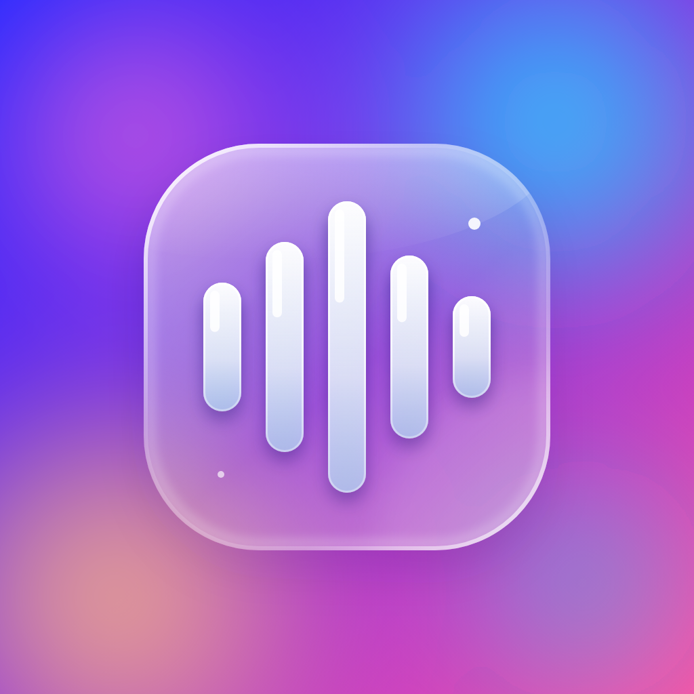

<p align="center">
  
</p>

# AI Smart Ringtone Studio — Android

Ứng dụng tạo nhạc chuông ngay trên điện thoại: chọn bài hát, cắt đoạn hay nhất, thêm fade, rồi đặt làm nhạc chuông / thông báo / báo thức. Mọi xử lý diễn ra cục bộ trên thiết bị.

## Giao diện dashboard (v0.3.0)
Ứng dụng có thanh điều hướng 4 tab theo bố cục của các mẫu Vue Admin Dashboard, viết lại hoàn toàn bằng Jetpack Compose với phong cách liquid glass:
- **Tổng quan:** thẻ số liệu (số nhạc chuông, tổng thời lượng, dung lượng, độ dài trung bình), biểu đồ cột 7 ngày, phân bố theo chất lượng và hoạt động gần đây.
- **Tạo mới:** màn hình cắt nhạc, nghe thử, fade, xuất và đặt làm nhạc chuông.
- **Lịch sử:** mọi nhạc chuông đã xuất được lưu lại (tối đa 200), có nghe lại, đặt làm nhạc chuông/thông báo/báo thức, chia sẻ và xóa.
- **Cài đặt:** giá trị mặc định (bitrate, fade, âm lượng) và giao diện sáng/tối/theo hệ thống.

Giao diện lấy cảm hứng từ bố cục của các mẫu dashboard mã nguồn mở, không sao chép mã của dự án nào.

## Tính năng cắt nhạc (v0.2.0)
- Chọn file âm thanh hoặc video bằng Storage Access Framework; nhận file được chia sẻ hoặc mở từ app khác.
- Hiển thị sóng âm và **gợi ý đoạn hay nhất** (cửa sổ có năng lượng lớn nhất, tính trên máy, không cần Internet).
- Chọn đoạn bằng thanh trượt hai đầu, **nghe thử** đoạn đã chọn và kết quả sau khi xuất.
- Fade in, fade out, chỉnh âm lượng, chọn bitrate AAC (64–192 kbps), ước tính dung lượng.
- Xuất AAC trong container M4A bằng AndroidX Media3 Transformer, có thanh tiến trình và nút Hủy.
- **Lưu vào thư mục Ringtones / Notifications / Alarms** và **đặt làm mặc định** của hệ thống.
- Chia sẻ file kết quả; liên kết tới các nguồn nhạc miễn phí bản quyền (Pixabay, Jamendo, Free Music Archive).
- Giao diện tiếng Việt và tiếng Anh, giao diện sáng/tối, Material You trên Android 12+.
- Giữ trạng thái khi xoay màn hình (ViewModel), tự dọn file tạm.
- Lịch sử và cài đặt được lưu lâu dài trong bộ nhớ riêng của ứng dụng.

## Chưa có
- Tìm kiếm/tải nhạc ngay trong app (hiện chỉ có liên kết tới trang nguồn).
- AI nhận diện điệp khúc bằng mô hình học máy (hiện dùng năng lượng âm thanh).
- MP3 / Opus encoder.
- So sánh ABX và đánh giá chất lượng nghe.
- Kiểm thử trên thiết bị Xiaomi thực tế.

## Công nghệ
- Kotlin 2.2, Jetpack Compose (Material 3)
- AndroidX Media3 (ExoPlayer, Transformer) 1.10.0
- Android SDK 36, minSdk 26, JDK 17
- Android Gradle Plugin 8.13.2, Gradle 8.13

## Build bằng GitHub Actions
1. Vào tab **Actions** của repo.
2. Chọn **Build Android APK** và bấm **Run workflow** (hoặc push lên nhánh `main`).
3. Khi chạy xong, mở run mới nhất và tải `Smart-Ringtone-Studio-debug-apk` ở mục **Artifacts**.
4. Giải nén và cài `app-debug.apk` trên Android (cần cho phép cài từ nguồn không xác định).

Nếu build lỗi, các dòng lỗi chính được đưa lên mục **Annotations** ở đầu trang run, và toàn bộ log nằm trong artifact `build-log`. Workflow cũng chạy unit test ở một job riêng, nên test lỗi không chặn việc tạo APK.

## Build cục bộ
Cần JDK 17, Android SDK 36 và Gradle 8.13:

```
gradle assembleDebug
gradle testDebugUnitTest
```

## Phát hành bản ký số
Bản debug chỉ để thử nghiệm. Để tạo APK release đã ký:

1. Tạo khóa ký (làm một lần, giữ file này cẩn thận, mất khóa thì không cập nhật được app):
   ```
   keytool -genkeypair -v -keystore release.jks -alias ringtone \
     -keyalg RSA -keysize 2048 -validity 10000
   ```
2. Mã hóa khóa: `base64 -w0 release.jks` (trên macOS: `base64 -i release.jks`).
3. Vào **Settings > Secrets and variables > Actions** của repo, tạo 4 secret:
   - `KEYSTORE_BASE64`: chuỗi vừa mã hóa
   - `KEYSTORE_PASSWORD`: mật khẩu keystore
   - `KEY_ALIAS`: `ringtone` (hoặc tên bạn đặt)
   - `KEY_PASSWORD`: mật khẩu khóa
4. Chạy workflow **Build signed release APK**, rồi tải `Smart-Ringtone-Studio-release-apk` ở mục Artifacts.

Không bao giờ commit file `.jks` lên repo (`.gitignore` đã chặn sẵn).

## Đặt làm nhạc chuông
Lần đầu bấm **Lưu và đặt làm mặc định**, Android sẽ mở màn hình "Sửa đổi cài đặt hệ thống" để bạn cấp quyền cho app. Sau khi bật, quay lại app và bấm lại. Trên một số máy (ví dụ Xiaomi), nếu nhạc chuông không tự nhận, hãy vào Cài đặt > Âm thanh > Nhạc chuông rồi chọn file trong thư mục Ringtones.

## Ghi chú kỹ thuật
- Media3 Transformer dựa trên các codec mà Android MediaCodec hỗ trợ, nên khả năng đọc/ghi phụ thuộc thiết bị và định dạng nguồn.
- Phân tích sóng âm chỉ xét tối đa 15 phút đầu của file.
- Chỉ dùng nhạc bạn có quyền sử dụng; hãy kiểm tra giấy phép của từng bài.

## Logo
Logo kiểu liquid glass nằm ở `docs/logo.png` (1024×1024) và ảnh chia sẻ `docs/social-preview.png` (1280×640). Icon ứng dụng dùng hai lớp adaptive (`ic_launcher_bg.png`, `ic_launcher_foreground.png`) kèm lớp đơn sắc cho biểu tượng theo chủ đề của Android 13+.
